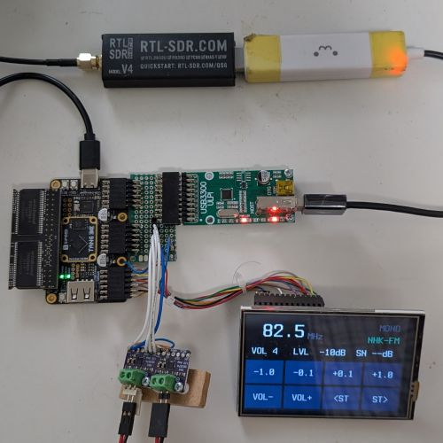

# atomvm-fm-radio

[English](README.md) | 日本語

AtomVM の上で動く、FM ステレオ放送の受信機です（Sipeed Tang Primer 25K）。復調の処理は、
すべて Elixir で書かれていて、FPGA の中で動きます。RTL-SDR から来る IQ のデータは、USB ホスト
からパイプラインを通って、I2S のアンプまで、CPU を通らずに流れます。その間、CPU の上では、
Elixir のプログラムがタッチパネルの画面を動かします。

[atomvm-tang25k-hls](https://github.com/elixir-hls/atomvm-tang25k-hls)（[elixir-hls](https://github.com/elixir-hls/elixir-hls) を使う）と、
次の部品のパッケージで作っています（mix.exs、hls.env）。
[atomvm-tang25k-usb-host](https://github.com/elixir-hls/atomvm-tang25k-usb-host)、
[atomvm-tang25k-rtlsdr](https://github.com/elixir-hls/atomvm-tang25k-rtlsdr)、
[atomvm-tang25k-i2s](https://github.com/elixir-hls/atomvm-tang25k-i2s)、
[atomvm-tang25k-rpi-display-3.5inch](https://github.com/elixir-hls/atomvm-tang25k-rpi-display-3.5inch)。



上が RTL-SDR Blog V4 で、USB ハブにつながっています。Dock の右にあるのが、USB ホストの PHY
になる USB3300（ULPI）のボードです。PMOD J5 には、MAX98357A の I2S アンプが 2 つ（左右に 1 つ
ずつ）つながり、手前にタッチパネル付きの 3.5 インチの液晶があります。

```elixir
use EHLS, blocks: [EHLS.USBHost, EHLS.I2S, EHLS.RPiDisplay35], peripherals: [:lcd]

definstance radio do
  usb_bulk_in()
  |> iq_pair()                                        # IQ のバイト -> {I, Q} のワード
  |> window(31) |> map(&chan_tap/1)                   # チャネルフィルタ
  |> map(&phase/1) |> scan(&phase_step/2)             # CORDIC で位相を求め、その差分で FM を復調
  |> window(32) |> every(4) |> map(&mpx_tap/1)        # FIR で 1/4 に間引く: 240 kS/s の MPX
  |> scan(&pilot_pll/2)                               # 19 kHz のパイロットの PLL、L-R の取り出し、パイロットの測定
  |> window(224) |> every(5) |> map(&stereo_tap/1)    # FIR で 1/5 に間引く: 48 kHz の {L+R, L-R}
  |> scan(&stereo_out/3)                              # ステレオの混ぜ具合、マトリクス、デエンファシス -> {R, L}
  |> scan(&level/2)                                   # ピークのレベル（読み出せる状態）
  |> map(&volume/2)                                   # 音量（パラメータ）
  |> i2s_out()
end
```

`FMRadio.start` は、起動の周波数（lib/fm_radio.ex の `@freq`。関東の NHK-FM の 82.5 MHz）で
受信を始め、3.5 インチの液晶に操作パネル（lib/fm_panel.ex。1 つのプロセス）を出します。

```
  82.5 MHz                     STEREO
                               NHK-FM        局名（関東の局の一覧にあるとき）
  VOL 4   LVL -18dB  SN 52dB                 音量 0〜15（3 dB 刻み、起動時は 4）、ピークのレベル、パイロットとノイズの比
 [ -1.0 ] [ -0.1 ] [ +0.1 ] [ +1.0 ]         選局、MHz（76.0〜95.0。端で反対側に戻る）
 [ VOL- ] [ VOL+ ] [ <ST  ] [  ST> ]         音量、一覧の前の局 / 次の局
```

選局と音量のボタンは、押し続けると繰り返します。ステレオの混ぜ具合は、usb-rtl-sdr-tang25k と
同じ方法で、パイロットに合わせて変えます（FMStereo）。パイロットの PLL が、68 ms の窓ごとに
パイロットを測ります。直近の 32 窓での、パイロットの大きさと、その直交成分のばらつきの比
（パイロットとノイズの比。画面の SN）から、L-R をどれだけ混ぜるかを決めます。40 dB 以下では
モノラル、48 dB 以上では完全なステレオで、その間は直線的に変わります。混ぜる量は速く増え、
ゆっくり減ります。混ぜる量が半分以上のとき、画面に STEREO と出ます。

画面は、変わったところだけを描き直し、状態の行は、多くても 1 秒に 1 回だけ更新します。IQ の
データが 1 秒止まると、パネルが RTL-SDR を開き直します。`FMDemo` は、決まった手順で動かす版です
（モノラルとステレオの切り替え、2 つの周波数、32 秒）。

コンソールからパイプラインを操作する例です。

```elixir
FMRadio.radio(:set, :gain, 16)      # 音量
FMRadio.radio(:set, :blend, 0)      # モノラル（256 でステレオ）
FMRadio.radio(:state, :level)       # ピークのレベル
FMRadio.pilot()                     # 最後のパイロットの窓: {番号, パイロットの I, パイロットの Q}
RTLSDR.tune(80_000_000)             # 別の局に切り替える
```

## ビルドと実行

先に入れておくものです（詳しくは、atomvm-tang25k と elixir-hls の README にあります）。

- Sipeed Tang Primer 25K と Dock、SDRAM のモジュール、[ハードウェア](#ハードウェア)の部品
- Elixir 1.18 以降、Erlang/OTP（28.3 で確かめています）、rebar3、gperf、cmake、ninja、python3
- Icarus Verilog（iverilog。12.0 で確かめています。ビルドのときに、どのカーネルもシミュレーションで
  確かめるのに使います）。Ubuntu / Debian では `sudo apt install iverilog`、macOS では
  `brew install icarus-verilog` で入ります。
- Gowin IDE（V1.9.11.03 Education で開発しました）。そのディレクトリを `GOWIN_HOME` に設定します。
- CIRCT 1.160.0 の配布バイナリ。そのディレクトリを `CIRCT_BIN` に設定します。
- Zephyr v4.4.2 の作業場所（`ZEPHYR_WORKSPACE`。既定は `~/zephyrproject`）と Zephyr SDK 1.0.1
- openFPGALoader 1.1.1 以降と、ボードの UART のための `ftdi_sio`

それ以外は Mix がそろえます。`mix deps.get` で、ターゲット（atomvm-tang25k-hls）、elixir-hls、
atomvm-tang25k、4 つの部品のパッケージが、mix.lock に記録された版で deps/ に入ります。

```sh
git clone https://github.com/elixir-hls/atomvm-fm-radio.git && cd atomvm-fm-radio
mix deps.get
B=deps/atomvm_tang25k/scripts                         # 最初に一度: 土台の LiteX、AtomVM、ホストの道具
$B/setup_litex.sh && $B/setup_atomvm.sh && $B/build_host.sh

H=deps/atomvm_tang25k_hls/scripts
$H/build_kernel.sh lib/fm_radio.ex lib/fm_coeffs.ex   # 10 本のカーネル。どれもシミュレーションで確かめる
$H/build_soc.sh                                       # SoC（数分。配置の設定は hls.env から）
$H/build_atomvm.sh && $H/flash.sh vm lib              # USB ホストと液晶の NIF を含む AtomVM
$H/build_ex.sh fm_radio FMRadio
SECONDS_RUN=20 $H/run.sh fm_radio                     # アップロードして受信する（そのまま鳴り続ける）
$H/flash.sh bitstream app fm_radio                    # 単独で起動: 電源を入れると受信機になる
$H/build_ex.sh fm_demo FMDemo && SECONDS_RUN=40 $H/run.sh fm_demo
```

部品のパッケージを手元で直しながら使うときは、mix.exs の依存先を、git のリポジトリの代わりに、
手元のディレクトリに向けます（`path: "../atomvm-tang25k-hls", override: true`）。依存先の
依存先（elixir-hls など）も手元のものを使うなら、それも同じように書きます。

## 試験

test/ref/*.sh は、Elixir の関数を、それが置き換えた usb-rtl-sdr-tang25k の Verilog の復調器
（test/ref/rtl/）と、ビット単位で比べます。`chan.sh`（チャネルフィルタ）、`disc.sh`（CORDIC の
弁別器）、`fir.sh`（2 つの FIR）、`mono_out.sh`（デエンファシス）、`stereo.sh`（パイロットの PLL と
パイロットの測定、ステレオの FIR、マトリクス）です。

## ハードウェア

Tang Primer 25K の Dock に、USB3300 の ULPI の PHY（PMOD J4 / J5）、その先の RTL-SDR（R828D）、
MAX98357A の I2S アンプ（J5）、3.5 インチの RPi Display（J6）をつなぎます。ピンは、各パッケージの
既定のものです（それぞれの README を見てください）。RTL-SDR は、USB3300 に直接つないでも、
USB 2.0 のハブを 1 段はさんでも動きます。PHY の RESET はつなぎません。

## ライセンス

Apache-2.0（[LICENSE](LICENSE) を参照）。
