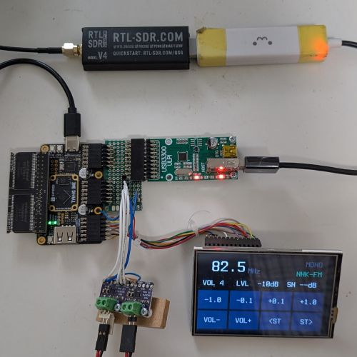

# atomvm-fm-radio

English | [日本語](README.ja.md)

A stereo FM radio on AtomVM (Sipeed Tang Primer 25K) whose whole demodulator is written in
Elixir and runs in the FPGA: the RTL-SDR's IQ goes from the USB host through the demodulator to
the I2S amplifiers without passing through the CPU, while Elixir on the CPU runs the touch
screen panel. Built with [atomvm-tang25k-hls](https://github.com/elixir-hls/atomvm-tang25k-hls) (with [elixir-hls](https://github.com/elixir-hls/elixir-hls))
and the part packages (mix.exs, config/config.exs)
[atomvm-tang25k-usb-host](https://github.com/elixir-hls/atomvm-tang25k-usb-host),
[atomvm-tang25k-rtlsdr](https://github.com/elixir-hls/atomvm-tang25k-rtlsdr),
[atomvm-tang25k-i2s](https://github.com/elixir-hls/atomvm-tang25k-i2s) and
[atomvm-tang25k-rpi-display-3.5inch](https://github.com/elixir-hls/atomvm-tang25k-rpi-display-3.5inch).



The RTL-SDR Blog V4 (top) on a USB hub, the USB3300 ULPI PHY board (right of the Dock) as
the USB host's PHY, two MAX98357A I2S amplifiers (one per channel) on PMOD J5 and the
3.5inch RPi Display with its touch panel.

```elixir
use EHLS, blocks: [EHLS.USBHost, EHLS.I2S, EHLS.RPiDisplay35], peripherals: [:lcd]

# the demodulator in four stream functions (lib/fm_radio.ex), joined with |>
defhls channel(iq :: stream(u16)) :: stream(u16) do                   # channel filter
  iq |> chunk_every(31, 1, :discard) |> map(&chan_tap/1)
end

defhls discriminator(iq :: stream(u16)) :: stream(s16) do             # CORDIC phase, its difference: FM
  iq |> map(&phase/1) |> transform(0, &phase_step/2)
end

defhls mpx(d :: stream(s16)) :: stream(s18) do                        # FIR /4: MPX at 240 kS/s
  d |> chunk_every(32, 4, :discard) |> map(&mpx_tap/1)
end

defhls stereo(x :: stream(s18), blend :: u9) :: stream(u32) do        # blend: 0 mono .. 256 stereo
  x
  |> transform({0, 0, 0, 0, 0, 0, 0, 0}, &pilot_pll/2, name: :pilot)  # 19 kHz pilot PLL, L-R mixed down, pilot windows
  |> chunk_every(225, 5, :discard) |> map(&stereo_tap/1)              # FIR /5: {L+R, L-R} at 48 kHz
  |> transform({0, 0, 0}, &stereo_out(&1, &2, blend))                # blend, matrix, de-emphasis -> {R, L}
end

definstance gain_hw(g :: u9), initial: 6 do                          # what the CPU changes while it plays:
  g                                                                   # levels the radio's functions read
end

definstance blend_hw(b :: u9), initial: 256 do
  b
end

definstance radio do
  usb_bulk_in()
  |> transform({0, 0}, &iq_pair/2)                    # IQ bytes -> {I, Q} words
  |> channel()
  |> discriminator()
  |> mpx()
  |> stereo(blend_hw(:value))
  |> transform(0, &level/2, name: :level)             # peak level (readable state)
  |> map(&volume(&1, gain_hw(:value)))                # gain
  |> i2s_out()
end
```

`FMRadio.start` plays the station it starts on (`@freq` in lib/fm_radio.ex: 82.5 MHz, NHK-FM
in the Kanto region) with the panel (lib/fm_panel.ex, one process) on the 3.5inch
RPi Display:

```
  82.5 MHz                     STEREO
                               NHK-FM        station name (Kanto list)
  VOL 4   LVL -18dB  SN 52dB                 volume 0..15 (3 dB steps; 4 at start), peak level, pilot / noise
 [ -1.0 ] [ -0.1 ] [ +0.1 ] [ +1.0 ]         tuning, MHz (76.0 .. 95.0, wraps around)
 [ VOL- ] [ VOL+ ] [ <ST  ] [  ST> ]         volume, previous / next station of the list
```

Tuning and volume repeat while held. The stereo blend follows the pilot as in
usb-rtl-sdr-tang25k (FMStereo): the pilot PLL measures the pilot over windows of 68 ms, and
its level against its quadrature's spread over the last 32 windows (pilot / noise, SN) sets
the L-R weight: mono at 36 dB or less, full stereo from 44 dB, linear in between, rising
quickly and falling slowly; STEREO while the weight is at least half.
Touching STEREO / MONO forces mono (`[MONO]`) and touching it again goes back to the pilot's
weight, to hear the two one after the other.
The screen redraws only what changed, the status line at most once a second. When the IQ
stops for a second the panel opens the RTL-SDR again. `FMDemo` is a scripted run instead
(mono / stereo, two stations, 32 s).

The radio from the console:

```elixir
FMRadio.gain_hw(16)                 # volume
FMRadio.blend_hw(0)                 # mono (256: stereo)
FMRadio.radio(:state, :level)       # peak level
FMRadio.pilot()                     # the last pilot window: {count, pilot I, pilot Q}
RTLSDR.tune(80_000_000)             # another station
```

## Build and run

What has to be installed first (the README of atomvm-tang25k and of elixir-hls tell more):

- Sipeed Tang Primer 25K + Dock with the SDRAM module, the parts of [Hardware](#hardware)
- Elixir 1.18 or later, Erlang/OTP (tested 28.3), rebar3, gperf, cmake, ninja, python3
- Icarus Verilog (iverilog, tested 12.0; every kernel is simulated in the build):
  `sudo apt install iverilog` on Ubuntu / Debian, `brew install icarus-verilog` on macOS
- The Gowin IDE (developed with V1.9.11.03 Education), its directory in `GOWIN_HOME`
- The CIRCT 1.160.0 release binaries, their directory in `CIRCT_BIN`
- A Zephyr v4.4.2 workspace (`ZEPHYR_WORKSPACE`, default `~/zephyrproject`) and Zephyr SDK 1.0.1
- openFPGALoader 1.1.1 or later, and `ftdi_sio` for the board's UART

Everything else comes with Mix: `mix deps.get` puts the target (atomvm-tang25k-hls), elixir-hls,
atomvm-tang25k and the four block packages into deps/ from Hex, at the versions of mix.lock.

```sh
git clone https://github.com/elixir-hls/atomvm-fm-radio.git && cd atomvm-fm-radio
mix deps.get
mix ehls.setup                                        # once for the machine: the base's LiteX, AtomVM and
                                                      # host tools (in ~/.cache/ehls, some tens of minutes)

mix ehls.doctor                                       # what is set, what is missing
mix ehls.build                                        # the kernels (each checked in simulation), the SoC
                                                      # (a few minutes), AtomVM with the NIFs, the pack
mix ehls.run --seconds 20                             # upload and play (keeps playing)
mix ehls.flash --standalone                           # power on -> the radio
```

The application's settings are in config/config.exs: the target, the module that starts
(`start: FMRadio`; `start: FMDemo` for the scripted run), Gowin's placement (`gowin: [place: 1]`,
the one with the most Fmax margin) and the instances in the FPGA on the host too
(`placement: :fpga`). Where the tools are on this machine (`GOWIN_HOME`, `UART_PORT`,
`ATOMVM_TANG25K`, ...) goes into config/local.exs (not committed) when they are neither found nor
in the environment; `mix ehls.doctor` lists them. `mix ehls.build` builds only what changed
(`--dry-run`: what would run).

The packages can also be worked on in place: point a dependency in mix.exs at a directory
instead of its Hex package (`path: "../atomvm-tang25k-hls", override: true`), and the
dependencies it brings (elixir-hls, ...) the same way if those are to come from directories
too.

## Tests

test/ref/*.sh compare the Elixir functions bit for bit with the Verilog demodulator of
usb-rtl-sdr-tang25k they replace (test/ref/rtl/), the stream functions run on the CPU with a
list: `chan.sh` (channel filter), `disc.sh`
(CORDIC discriminator), `fir.sh` (both FIRs), `mono_out.sh` (de-emphasis), `stereo.sh`
(pilot PLL with its pilot windows, stereo FIR, matrix).

## Hardware

Tang Primer 25K Dock with a USB3300 ULPI PHY (PMOD J4 / J5), an RTL-SDR (R828D) on it,
MAX98357A I2S amplifiers (J5) and the 3.5inch RPi Display (J6), on the packages' default pins
(their READMEs). The RTL-SDR works attached directly to the USB3300 or behind one USB 2.0 hub.
The PHY's RESET is left unconnected.

## License

The source in this repository is Apache-2.0 (see [LICENSE](LICENSE)).

It depends on [`atomvm_tang25k_rtlsdr`](https://hex.pm/packages/atomvm_tang25k_rtlsdr),
a port of librtlsdr, which is GPL-2.0-or-later. A built application (the AVM, or a flash
image with it) contains that package, so it goes out under the GPL-2.0-or-later as a whole.
